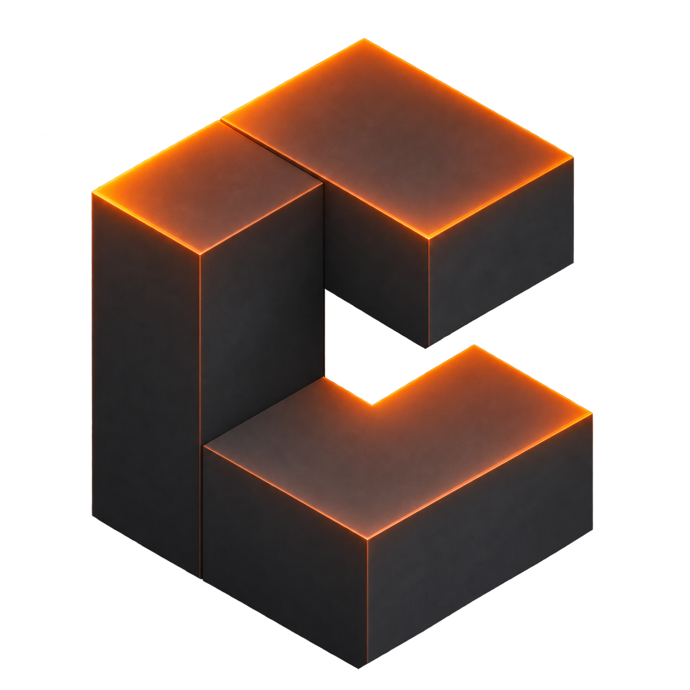
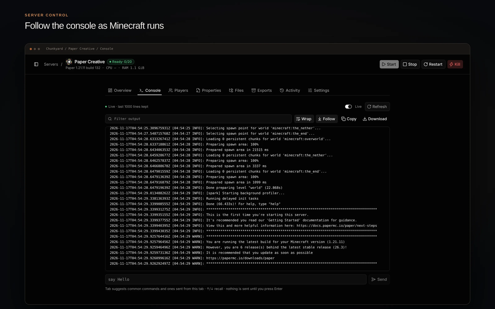
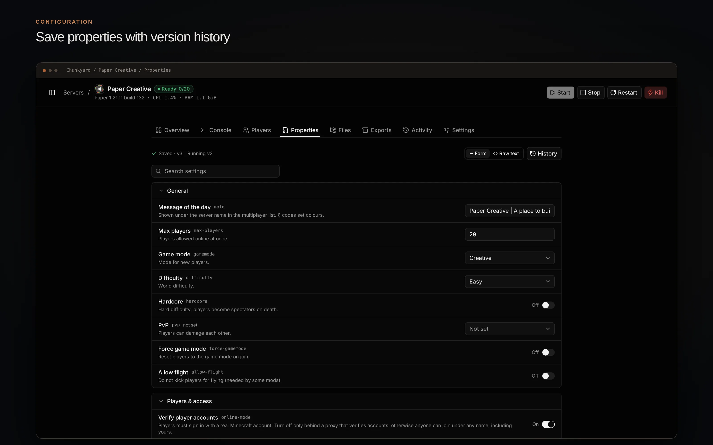
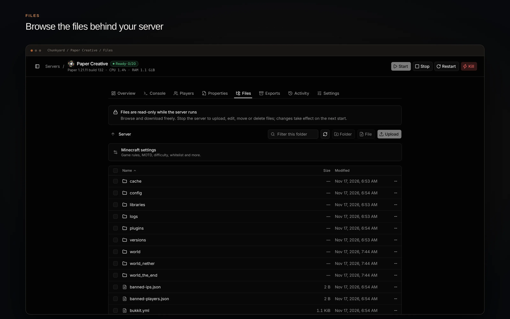
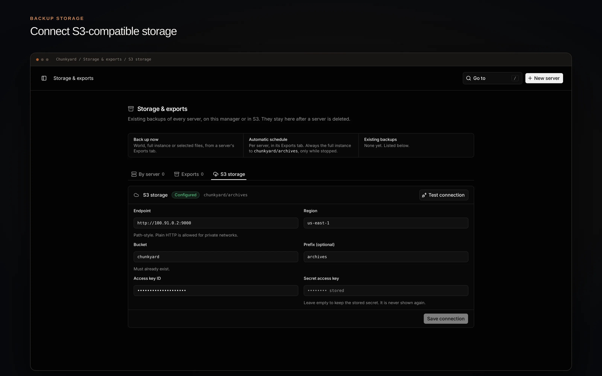
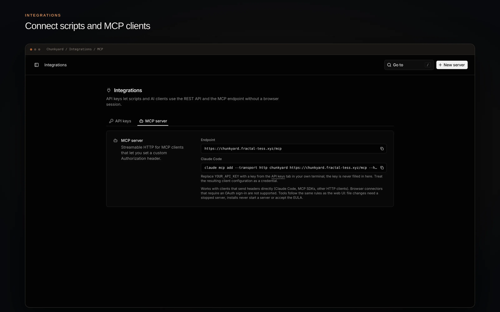
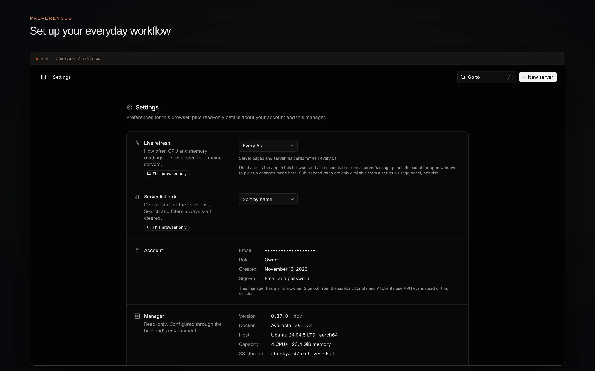

<p align="center">
  
</p>

<p align="center">
  <a href="docs/frontend.md"></a>
  <a href="CHANGELOG.md"></a>
</p>

<h1 align="center">Chunkyard</h1>

<p align="center">
  
</p>

<p align="center">Your Minecraft servers, in one yard.<br /><a href="https://chunkyard.fractal-tess.xyz">Open Chunkyard</a></p>

Chunkyard is a self-hosted Minecraft Java Edition server manager for one owner. Install server software, follow the console, change configuration, and keep backups from a single web interface. Each game server runs in its own Docker container, with a compatible Java image and persistent files.

- **Run** Vanilla, Paper, Purpur, Fabric, Forge, NeoForge, or a supported CurseForge server pack. Chunkyard downloads and verifies the files, records the installed version, and selects a compatible Java image. Custom JARs and launch profiles are available too.
- **Manage** servers with live console output, commands, Minecraft readiness checks, and resource charts. Edit files, save versioned `server.properties` changes, and adjust memory, CPU, ports, or launch settings.
- **Keep** worlds and instances in local or S3-compatible backups. Restore a full backup, or remove a stopped server's local files after verifying its full S3 restore point.

Owner login is enabled by default. Revocable API keys let scripts and MCP clients use the same server controls. The Rust service serves the built Svelte UI directly; production does not need a separate Node service. See [integrations](docs/integrations-contract.md) and [backup and restore](docs/exports-contract.md) for their contracts and limits.

The project is in active development. Chunkyard distinguishes a running container from a Minecraft server that is ready to accept connections.

## Run it

Build the image, including the web UI:

```sh
docker build -t chunkyard:local .
```

Follow the [Docker setup](docs/docker.md#run-the-manager-in-docker) to mount persistent storage and the Docker socket, then open `http://127.0.0.1:8420`. Authentication is enabled by default; the initial setup token is stored in the data directory.

For a source checkout, see [production UI hosting](docs/frontend.md#production-hosting) and [backend development](docs/backend.md). The executable is `mcm`; configuration uses `CHUNKYARD_*` environment variables.

## A closer look

Captured from the deployed app with Vanilla and Paper servers running.

<table>
  <tr>
    <td width="50%"><a href="assets/screenshots/console.webp"></a></td>
    <td width="50%"><a href="assets/screenshots/properties.webp"></a></td>
  </tr>
  <tr>
    <td><a href="assets/screenshots/files.webp"></a></td>
    <td><a href="assets/screenshots/storage.webp"></a></td>
  </tr>
  <tr>
    <td><a href="assets/screenshots/integrations.webp"></a></td>
    <td><a href="assets/screenshots/settings.webp"></a></td>
  </tr>
</table>

## Documentation

[Web UI](docs/frontend.md) · [Docker runtime and deployment](docs/docker.md) · [REST API](docs/http-api.md) · [API keys and MCP](docs/integrations-contract.md) · [Backups](docs/exports-contract.md) · [Monitoring](docs/monitoring.md) · [Backend development](docs/backend.md) · [Contributing](CONTRIBUTING.md) · [Changelog](CHANGELOG.md)

The [phase specifications](specs/README.md) describe the broader roadmap. The usage guides document what is implemented today.
