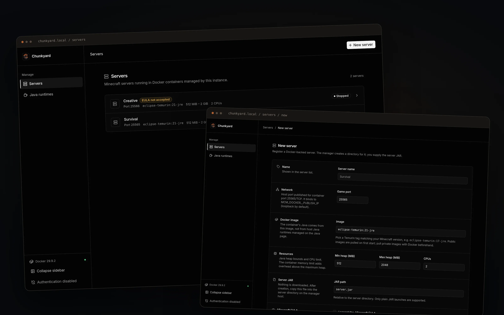

<p align="center">
  
</p>

<p align="center">
  <a href="docs/frontend.md"></a>
  <a href="CHANGELOG.md"></a>
</p>

<h1 align="center">Chunkyard</h1>

<p align="center">
  
</p>

<p align="center">Your Minecraft servers, in one yard.<br /><a href="https://chunkyard.fractal-tess.xyz">Open Chunkyard</a></p>

Chunkyard is a self-hosted Minecraft Java Edition server manager for one owner. A Rust service and Svelte web UI let you manage Docker server instances from one address, with persistent storage and no separate Node service to run.

- **Control** servers with start, stop, restart, and force kill. Read recent console output, send commands, and watch CPU, memory, and uptime.
- **Choose** a Docker image's Java version for each server, and discover or install host Java runtimes separately.
- **Keep** a simple owner login, or disable authentication explicitly for a trusted local environment.

This project is in active development. Bring your own server JAR; automatic server/modpack installers, file management, and backups are still on the roadmap. Host-managed Java installations are not used by Docker servers. Container status does not establish Minecraft readiness.

## Run it

Build the image, including the web UI:

```sh
docker build -t chunkyard:local .
```

Follow the [Docker setup](docs/docker.md#run-the-manager-in-docker) to mount persistent storage and the Docker socket, then open `http://127.0.0.1:8420`. Authentication is enabled by default; the initial setup token is stored in the data directory.

For a source checkout, see [production UI hosting](docs/frontend.md#production-hosting) and [backend development](docs/backend.md). The executable is `mcm`; configuration continues to use `MCM_*` environment variables.

## Documentation

[Web UI](docs/frontend.md) · [Docker runtime and deployment](docs/docker.md) · [REST API](docs/http-api.md) · [Monitoring](docs/monitoring.md) · [Oracle trial](docs/oracle-trial.md) · [Backend development](docs/backend.md) · [Contributing](CONTRIBUTING.md) · [Changelog](CHANGELOG.md)

The [phase specifications](specs/README.md) describe the broader roadmap. The usage guides document what is implemented today.
