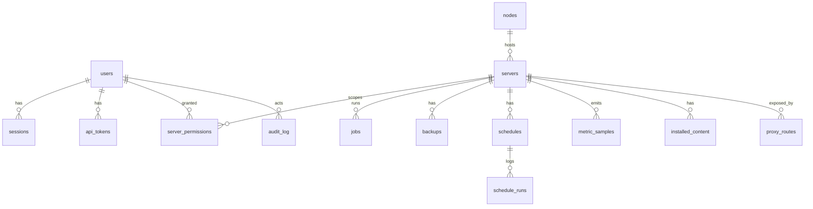

# Data model (SQLite)

Owned by `mcm-db`. This file is the cumulative **sketch** of core shape. **Each phase's `api.md` migration is authoritative** and may add columns/tables noted under "Deltas" below; when they differ, the phase file wins. Column types are SQLite affinities; `id` columns are UUIDv7 TEXT; timestamps are INTEGER unix milliseconds UTC; booleans INTEGER 0/1; JSON columns are TEXT validated by serde on read.

## Connection settings

`journal_mode=WAL`, `synchronous=NORMAL`, `foreign_keys=ON`, `busy_timeout=5000`. Pool: 8 connections; a dedicated single-connection writer is **not** used (WAL + busy_timeout suffices at this scale).

## Entity overview



## Tables by phase

### Phase 0 — foundation

```sql
CREATE TABLE users (
  id TEXT PRIMARY KEY, username TEXT NOT NULL UNIQUE COLLATE NOCASE,
  password_hash TEXT NOT NULL,              -- argon2id PHC string
  role TEXT NOT NULL CHECK (role IN ('owner','admin','user')),
  disabled INTEGER NOT NULL DEFAULT 0, must_change_password INTEGER NOT NULL DEFAULT 0,
  totp_secret_enc BLOB, totp_last_step INTEGER,   -- 2FA (P0)
  created_at INTEGER NOT NULL, updated_at INTEGER NOT NULL
);
CREATE TABLE sessions (
  id_hash BLOB PRIMARY KEY,                 -- sha256(session token)
  user_id TEXT NOT NULL REFERENCES users(id) ON DELETE CASCADE,
  created_at INTEGER NOT NULL, last_seen_at INTEGER NOT NULL, expires_at INTEGER NOT NULL,
  ip TEXT, user_agent TEXT
);
CREATE TABLE api_tokens (
  id TEXT PRIMARY KEY, user_id TEXT NOT NULL REFERENCES users(id) ON DELETE CASCADE,
  name TEXT NOT NULL, token_hash BLOB NOT NULL UNIQUE, prefix TEXT NOT NULL,   -- first 8 chars for display
  scopes TEXT NOT NULL,                     -- JSON array of Permission, or ["*"]
  server_ids TEXT,                          -- JSON array; NULL = all servers the user can access
  expires_at INTEGER, last_used_at INTEGER, created_at INTEGER NOT NULL
);
CREATE TABLE audit_log (
  id INTEGER PRIMARY KEY AUTOINCREMENT, ts INTEGER NOT NULL,
  actor_user_id TEXT, actor_token_id TEXT, actor_ip TEXT,
  action TEXT NOT NULL,                     -- e.g. "server.start", "files.write"
  target_type TEXT, target_id TEXT, server_id TEXT,
  outcome TEXT NOT NULL CHECK (outcome IN ('success','failure')),
  details TEXT                              -- JSON, secrets never included
);
CREATE INDEX audit_ts ON audit_log(ts); CREATE INDEX audit_server ON audit_log(server_id, ts);
CREATE TABLE jobs (
  id TEXT PRIMARY KEY, kind TEXT NOT NULL, server_id TEXT,   -- no FK: servers table arrives in phase 1; service deletes jobs with server
  state TEXT NOT NULL CHECK (state IN ('queued','running','succeeded','failed','cancelled')),
  progress REAL, message TEXT, error_code TEXT, error_detail TEXT,
  params TEXT NOT NULL, result TEXT,
  created_by TEXT, created_at INTEGER NOT NULL, started_at INTEGER, finished_at INTEGER
);
CREATE TABLE settings (key TEXT PRIMARY KEY, value TEXT NOT NULL);  -- runtime-editable settings (JSON values)
```


### Phase 1 — servers

```sql
CREATE TABLE servers (
  id TEXT PRIMARY KEY, name TEXT NOT NULL, slug TEXT NOT NULL UNIQUE,   -- display handle only; dir = servers/<id>
  node_id TEXT,                                 -- NULL = local (phase 10)
  flavor TEXT NOT NULL,                         -- vanilla|paper|purpur|fabric|quilt|forge|neoforge|custom
  mc_version TEXT, loader_version TEXT,
  launch TEXT NOT NULL,                         -- JSON LaunchSpec
  java_runtime_id TEXT,                         -- NULL = java_path used
  java_path TEXT,
  memory_min_mb INTEGER NOT NULL, memory_max_mb INTEGER NOT NULL,
  jvm_args TEXT NOT NULL DEFAULT '[]',          -- JSON array
  env TEXT NOT NULL DEFAULT '{}',
  port INTEGER NOT NULL, rcon_port INTEGER, rcon_password_enc BLOB,
  stop_command TEXT NOT NULL DEFAULT 'stop', stop_timeout_s INTEGER NOT NULL DEFAULT 60,
  start_timeout_s INTEGER NOT NULL DEFAULT 600,
  ready_pattern TEXT,
  auto_start INTEGER NOT NULL DEFAULT 0,
  restart_on_crash INTEGER NOT NULL DEFAULT 1, max_restarts INTEGER NOT NULL DEFAULT 3,
  restart_window_s INTEGER NOT NULL DEFAULT 600,
  last_state TEXT NOT NULL DEFAULT 'stopped',
  created_at INTEGER NOT NULL, updated_at INTEGER NOT NULL
);
-- NULLs are distinct in SQLite unique indexes, so use an expression index:
CREATE UNIQUE INDEX servers_port ON servers(IFNULL(node_id, ''), port);
```

### Phase 3 — Java & installers

```sql
CREATE TABLE java_runtimes (
  id TEXT PRIMARY KEY, vendor TEXT NOT NULL, major INTEGER NOT NULL, full_version TEXT NOT NULL,
  arch TEXT NOT NULL, os TEXT NOT NULL, path TEXT NOT NULL,      -- path to bin/java
  managed INTEGER NOT NULL,                                     -- 1 = downloaded by mcm
  sha256 TEXT, installed_at INTEGER NOT NULL
);
```

### Phase 4 — content

```sql
CREATE TABLE installed_content (
  id TEXT PRIMARY KEY, server_id TEXT NOT NULL REFERENCES servers(id) ON DELETE CASCADE,
  kind TEXT NOT NULL CHECK (kind IN ('mod','plugin','datapack','resourcepack')),   -- packs tracked in pack_imports
  platform TEXT NOT NULL CHECK (platform IN ('curseforge','modrinth','hangar','manual')),
  project_id TEXT, version_id TEXT, name TEXT NOT NULL, file_path TEXT,   -- sandbox-relative
  sha1 TEXT, enabled INTEGER NOT NULL DEFAULT 1, side TEXT,               -- server|both|client_suspected
  installed_at INTEGER NOT NULL
);
CREATE TABLE pending_manual_downloads (
  id TEXT PRIMARY KEY, job_id TEXT NOT NULL, server_id TEXT NOT NULL,
  project_id TEXT NOT NULL, file_id TEXT NOT NULL, file_name TEXT NOT NULL,
  website_url TEXT NOT NULL, sha1 TEXT, fingerprint INTEGER, target_path TEXT NOT NULL,
  resolved_at INTEGER
);
```

### Phase 5 — metrics

```sql
CREATE TABLE metric_samples (
  server_id TEXT NOT NULL, resolution INTEGER NOT NULL,   -- seconds: 10, 60, 3600
  ts INTEGER NOT NULL,
  cpu_pct REAL, rss_mb REAL, disk_mb REAL, players INTEGER, tps REAL, mspt REAL,
  PRIMARY KEY (server_id, resolution, ts)
) WITHOUT ROWID;
CREATE TABLE player_sessions (
  id INTEGER PRIMARY KEY, server_id TEXT NOT NULL, player_name TEXT NOT NULL, player_uuid TEXT,
  joined_at INTEGER NOT NULL, left_at INTEGER
);
```

### Phase 6 — backups & schedules

```sql
CREATE TABLE storage_targets (id TEXT PRIMARY KEY, name TEXT NOT NULL, kind TEXT NOT NULL CHECK (kind IN ('local','s3')),
  config TEXT NOT NULL, secret_enc BLOB, created_at INTEGER NOT NULL);
CREATE TABLE backups (
  id TEXT PRIMARY KEY, server_id TEXT NOT NULL REFERENCES servers(id) ON DELETE CASCADE,
  target_id TEXT NOT NULL REFERENCES storage_targets(id), object_key TEXT NOT NULL,
  kind TEXT NOT NULL CHECK (kind IN ('full','world')), size_bytes INTEGER, sha256 TEXT,
  state TEXT NOT NULL, note TEXT, locked INTEGER NOT NULL DEFAULT 0, created_at INTEGER NOT NULL
);
CREATE TABLE backup_policies (server_id TEXT PRIMARY KEY REFERENCES servers(id) ON DELETE CASCADE,
  target_id TEXT NOT NULL, include TEXT NOT NULL, exclude TEXT NOT NULL,
  keep_last INTEGER, keep_daily INTEGER, keep_weekly INTEGER, keep_monthly INTEGER);
CREATE TABLE schedules (
  id TEXT PRIMARY KEY, server_id TEXT NOT NULL REFERENCES servers(id) ON DELETE CASCADE,
  name TEXT NOT NULL, cron TEXT NOT NULL, timezone TEXT NOT NULL, enabled INTEGER NOT NULL,
  only_when_running INTEGER NOT NULL DEFAULT 0, steps TEXT NOT NULL,   -- JSON array of TaskStep
  next_run_at INTEGER, created_at INTEGER NOT NULL
);
CREATE TABLE schedule_runs (id INTEGER PRIMARY KEY, schedule_id TEXT NOT NULL REFERENCES schedules(id) ON DELETE CASCADE,
  started_at INTEGER NOT NULL, finished_at INTEGER, outcome TEXT, detail TEXT);
```

### Phase 7 — network exposure (routes, port mappings)

```sql
CREATE TABLE proxy_routes (
  id TEXT PRIMARY KEY, server_id TEXT NOT NULL REFERENCES servers(id) ON DELETE CASCADE,
  hostname TEXT NOT NULL UNIQUE COLLATE NOCASE, send_proxy_protocol INTEGER NOT NULL DEFAULT 0,
  enabled INTEGER NOT NULL DEFAULT 1
);
CREATE TABLE port_mappings (id TEXT PRIMARY KEY, external_port INTEGER NOT NULL, internal_port INTEGER NOT NULL,
  protocol TEXT NOT NULL, method TEXT NOT NULL, lease_expires_at INTEGER, last_error TEXT);
```

### Phase 9 — relay

```sql
CREATE TABLE relay_connections (id TEXT PRIMARY KEY, name TEXT NOT NULL, endpoint TEXT NOT NULL,
  cert_fingerprint TEXT NOT NULL, token_enc BLOB NOT NULL, enabled INTEGER NOT NULL, created_at INTEGER NOT NULL);
```

### Phase 8 — users, permissions, notifications

```sql
CREATE TABLE server_permissions (user_id TEXT NOT NULL REFERENCES users(id) ON DELETE CASCADE,
  server_id TEXT NOT NULL REFERENCES servers(id) ON DELETE CASCADE, permissions TEXT NOT NULL,  -- JSON array
  PRIMARY KEY (user_id, server_id));
CREATE TABLE notification_channels (id TEXT PRIMARY KEY, name TEXT NOT NULL, kind TEXT NOT NULL CHECK (kind IN ('discord','webhook')),
  url_enc BLOB NOT NULL, secret_enc BLOB, events TEXT NOT NULL, server_ids TEXT, enabled INTEGER NOT NULL);
CREATE TABLE notification_deliveries (id INTEGER PRIMARY KEY, channel_id TEXT NOT NULL, event TEXT NOT NULL,
  ts INTEGER NOT NULL, status INTEGER, attempts INTEGER NOT NULL, error TEXT);
```

### Phase 11 — nodes (post-1.0)

```sql
CREATE TABLE nodes (id TEXT PRIMARY KEY, name TEXT NOT NULL, url TEXT NOT NULL, token_enc BLOB NOT NULL,
  cert_fingerprint TEXT, last_seen_at INTEGER, version TEXT, created_at INTEGER NOT NULL);
```

## Deltas introduced by phase migrations

| Phase | Additions beyond the sketch above |
|---|---|
| 3 | `servers.java_auto`, `servers.java_override`, `servers.installed_build`; `java_runtimes.path` UNIQUE |
| 4 | `pack_imports` table; `pending_manual_downloads.state`, `.pack_import_id`; `installed_content.version`, `.side_reasons`, UNIQUE `(server_id, file_path)` |
| 5 | `metric_samples.rss_max_mb`, `.mspt_max`; `player_sessions.close_reason`; `server_state_history` table; `server_id = 'host'` sentinel for host metrics |
| 6 | `backups.server_id` nullable `ON DELETE SET NULL` (backups survive server deletion) + `format`, `hot`, `server_name`, `server_slug`, `job_id`; `schedules.misfire`, `.last_scheduled_for`; `schedule_runs.id` TEXT |
| 0 | TOTP columns/tables moved here from P8: `users.totp_secret_enc`, `users.totp_last_step`, `totp_recovery_codes` |
| 7 | `proxy_routes.wake_on_join`, `.exposure`; `proxy_route_stats`; reshaped `port_mappings` |
| 9 | `relay_connections`; `proxy_routes.relay_id` |
| 8 | `user_invites`, `user_notifications`; token `admin` scope upgrade; `server_permissions.updated_at`; channel columns `url_preview`, `consecutive_failures`, `disabled_reason` |
| 10 | `servers.runtime` (`native`/`shim`/`docker`) + limit columns |
| 11 | `jobs.node_id`, `storage_targets.node_id`; agent DB uses separate `migrations-agent/` (post-1.0) |

Phase 2 adds no tables (upload sessions are files under `uploads/`, trash is `.mcm/trash/`, `restart_required` is in-memory supervisor status).

## Secrets at rest

Columns suffixed `_enc` are encrypted with XChaCha20-Poly1305 using the **master key** at `<data>/secret.key` (32 random bytes, mode 0600, created on first start). Format: `nonce(24) || ciphertext`; AAD = `"<table>.<column>:<row_id>"` (e.g. `servers.rcon_password_enc:0193…`). Losing the key loses those secrets (documented). See [security.md](security.md).

## Retention

| Table | Retention |
|---|---|
| `audit_log` | 365 days (configurable) |
| `metric_samples` | 10 s: 48 h · 60 s: 14 d · 3600 s: 400 d |
| `jobs` | 30 days after finish |
| `sessions` | deleted on expiry (hourly sweeper) |
| `notification_deliveries`, `schedule_runs` | 30 days |
