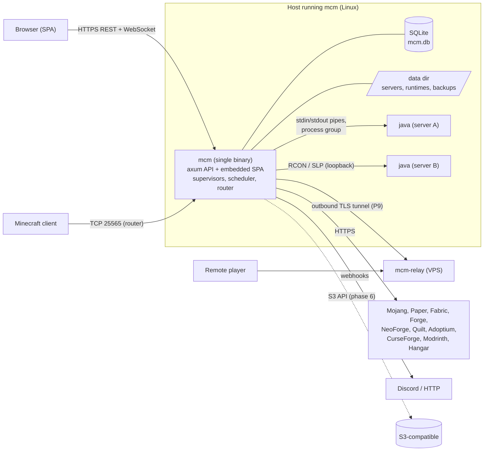
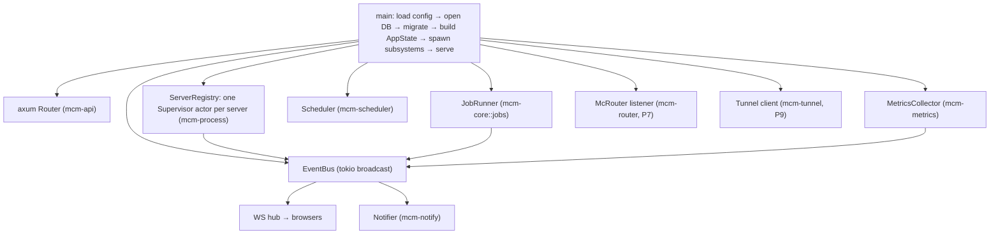

# Architecture overview

Read this first. Every other architecture file zooms into one concern; [patterns.md](patterns.md) is binding for all phases.

## System context

## Components

| Component | Form | Responsibility |
|---|---|---|
| `mcm` | Binary crate `mcm-server` | HTTP/WS API, static SPA, server supervisors, jobs, scheduler, metrics, router, port mapping, tunnel client |
| `mcm-relay` | Binary crate `mcm-relay` (P9) | Public-facing TCP relay; accepts agent tunnels; routes players by hostname or port |
| `mcm-shim` | Binary crate `mcm-shim` (P10) | Holds a server's stdio across mcm restarts (unix socket + log file) |
| `fake-mc-server` | Test-only binary | Mimics a Minecraft server (stdout, stdin, SLP, RCON) so CI does not need Java |
| SPA | SvelteKit static build | UI; talks only to `/api/v1` and `/api/v1/ws` |

## Technology choices

| Concern | Choice | Why |
|---|---|---|
| HTTP | axum 0.8 + tower-http | First-class tokio integration, extractor model, WebSocket support, wide ecosystem |
| Runtime | tokio (multi-thread) | Required by axum, sqlx, process/pipe handling |
| DB | SQLite via sqlx (bundled libsqlite3, WAL mode) | Single-binary deploy, zero ops; compile-time checked queries (`sqlx::query_as!` with offline `.sqlx` data) |
| OpenAPI | utoipa + utoipa-axum | Spec derived from handler annotations; never hand-written |
| TS client | openapi-typescript + openapi-fetch | Types-only generation, tiny runtime, no codegen classes |
| TLS | rustls (no OpenSSL) | Static/musl builds; used by reqwest, relay tunnel, optional HTTPS listener |
| HTTP client | reqwest (rustls) | Downloads, external APIs |
| Password hash | argon2 (argon2id) | Current OWASP recommendation |
| Archives | `zip`, `tar` + `zstd`, `flate2` | zip for user up/download and packs, `.tar.zst` for backups |
| Cron | `croner` | 5/6-field cron with timezone support via `chrono-tz` |
| Process stats | `sysinfo` | Cross-platform CPU/RSS; Linux `/proc` fallback for process-tree sums |
| Frontend | SvelteKit 2 + Svelte 5 runes, `adapter-static`, shadcn-svelte, Tailwind v4, CodeMirror 6, xterm.js (console), LayerChart (graphs) | Fixed by user; xterm.js gives correct ANSI rendering for free |
| Embedding | `rust-embed` | SPA compiled into binary; in dev, Vite serves the UI and proxies `/api` to mcm ([frontend.md](frontend.md#embedding-and-dev-loop)) |

## Platform stance

| Platform | Status |
|---|---|
| Linux x86_64 / aarch64 (glibc and musl) | **Supported.** All features. |
| macOS | Development only. Builds and unit tests run in CI; not a release target. |
| Windows | **Not supported in v1.** Recommended path is WSL2 or the Docker image. Platform-specific code (process groups, signals, file permissions) lives behind the `mcm_process::platform` module so a Windows backend (Job Objects, `CTRL_BREAK`) can be added without touching callers. |

> Native-runtime servers stop when mcm restarts (P1–P9); the shim and Docker runtimes (P10) survive restarts. See [process-model.md](process-model.md).

## Runtime topology inside `mcm`

- All long-lived subsystems receive a child `CancellationToken` of the root token; SIGINT/SIGTERM cancels root → graceful shutdown (see [process-model.md](process-model.md#manager-shutdown)).
- Cross-subsystem communication goes through the typed `EventBus` (`mcm_core::events::Event`), never direct calls in both directions.

## Request lifecycle

1. tower layers: request id → tracing span → compression → timeout (30 s, excluded for upload/download/WS) → body limit.
2. Auth extractor resolves `Principal` from session cookie or bearer token ([auth.md](auth.md)).
3. Handler (thin) validates input DTO, calls a service trait from `AppState`, maps result to DTO.
4. Errors convert to `ApiError` → RFC 9457 problem+json ([errors-and-logging.md](errors-and-logging.md)).
5. Mutating handlers emit an `AuditEvent` via the audit service.

## Long-running work: jobs

Anything that can take more than ~2 s (install, download, pack import, backup, restore, clone, world reset) is a **job**:

- Created via the API, returns `202 Accepted` + `{ "job": Job }`.
- Persisted in `jobs` table; progress published on the bus (`job.progress`) and the WS topic `jobs`.
- Cancellable via `POST /api/v1/jobs/{id}/cancel` (cancels the job's `CancellationToken`).
- On manager restart, jobs left `running` are marked `failed` with reason `interrupted`.
- At most one mutating job per server at a time (`server_busy` 409 otherwise).

## Related files

[workspace-layout](workspace-layout.md) · [patterns](patterns.md) · [process-model](process-model.md) · [log-formats](log-formats.md) · [server-api](server-api.md) · [audit](audit.md) · [data-model](data-model.md) · [api-conventions](api-conventions.md) · [auth](auth.md) · [security](security.md) · [errors-and-logging](errors-and-logging.md) · [config](config.md) · [filesystem-layout](filesystem-layout.md) · [frontend](frontend.md)
