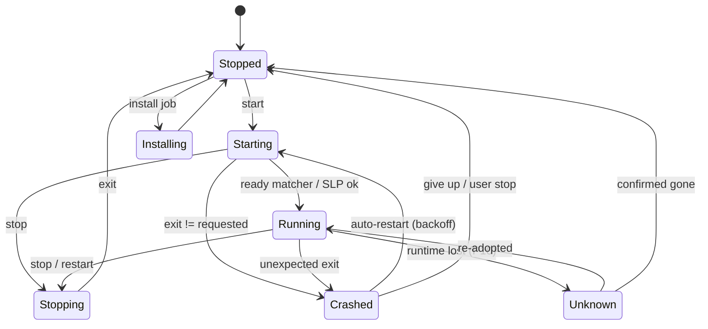

# Process model

Owned by `chunkyard-process`. This file holds the **single definition** of the `ProcessSpawner` trait; P1 (native), P10 (Docker, shim) and P11 (remote) reference it.

> **Limitation (P1–P9, native runtime): servers stop when mcm stops or restarts.** Native children are tied to mcm's stdio pipes and receive `SIGTERM` via `PR_SET_PDEATHSIG` if mcm dies; mcm cannot re-attach to them. Upgrading mcm therefore restarts all servers. P10 adds the `shim` and `docker` runtimes, which survive mcm restarts and are re-adopted via `ProcessSpawner::adopt()`.

## Server state machine



`Status { state, pid, started_at, ready_at, exit: Option<ExitInfo>, restart_count, … }` is published via `watch` and `Event::ServerStatusChanged`. `Status` is **additive**: later phases add fields (`restart_required` P2, `last_install_error` P3, `maintenance` P6) and values (`Unknown` state and `oom_killed` reason in P10). Clients ignore unknown fields/values.

`ExitInfo.reason`: `requested`, `killed`, `crashed`, `crash_loop`, `eula_required`, `start_failed`, `oom_killed` (P10).

**Maintenance flag** (P6): while set (restore, world reset), auto-restart, schedules and wake-on-join are suppressed and start returns `409 server.maintenance`.

## Spawner trait (single definition)

```rust
// chunkyard-core::process — trait; impls: NativeSpawner (P1), ShimSpawner + DockerSpawner (P10), RemoteSpawner (P11)
#[async_trait]
pub trait ProcessSpawner: Send + Sync {
    async fn spawn(&self, spec: &SpawnSpec) -> Result<Box<dyn ChildProcess>, ProcessError>;
    /// Re-attach to an instance still running after an mcm restart.
    /// NativeSpawner always returns Ok(None) (and kills verified orphans, see below).
    async fn adopt(&self, server: ServerId, hint: &AdoptHint) -> Result<Option<Box<dyn ChildProcess>>, ProcessError>;
    fn capabilities(&self) -> SpawnerCaps; // { survives_manager_restart, memory_limit, cpu_limit, pids_limit }
}
#[async_trait]
pub trait ChildProcess: Send {
    fn stdin(&mut self) -> &mut (dyn AsyncWrite + Send + Unpin);
    fn take_output(&mut self) -> OutputStreams;            // stdout + stderr readers
    async fn signal(&mut self, sig: StopSignal) -> Result<(), ProcessError>; // Term | Kill (group/container)
    async fn wait(&mut self) -> Result<ExitInfo, ProcessError>;
    fn pid(&self) -> Option<u32>;
    /// Lines produced while mcm was away (shim/docker), replayed into the ring on adopt.
    fn backlog(&mut self) -> Option<OutputStreams> { None }
}
pub struct AdoptHint { pub state_dir: PathBuf, pub last_epoch: Option<Epoch>, pub last_pid: Option<u32> }
```

`ServerHandle` also offers `expect_line(matcher, timeout)` (subscribe-then-send, used for `save-all flush` and installers). Captured command output is only available via RCON (P5), never via stdin.

## State directory (not inside the server dir)

chunkyard-owned state lives in `<data>/state/<server-id>/`, **outside** the user-writable server directory: `pid`, `console.log[.1-5]`, `crash-<ts>.log`, `install.log`, trash metadata, shim socket (P10). Nothing a user can write via the file manager, an upload, a pack, or a restored backup is ever read back as trusted mcm state. See [filesystem-layout.md](filesystem-layout.md) and [security.md](security.md#untrusted-server-directory).

## Spawning (native)

```
<java_path> <jvm_args...> -Xms<min>M -Xmx<max>M <launch target> nogui
  cwd   = <data>/servers/<id>/
  env   = cleared, then PATH, HOME=<server dir>, LANG=C.UTF-8, TZ, plus user env (allow-listed keys)
  stdin/stdout/stderr = piped
  process_group(0)                            # new pgid = child pid
  pre_exec: prctl(PR_SET_PDEATHSIG, SIGTERM); if getppid() != expected_ppid { _exit(1) }
```

### Dedicated spawner thread

`PR_SET_PDEATHSIG` fires when the **thread** that forked the child exits, not the process. Spawning from a tokio worker or a `spawn_blocking` thread (which is reaped after the blocking pool's 10 s keep-alive) would SIGTERM healthy servers. Therefore all native spawns go through **one dedicated, long-lived OS thread** (`chunkyard-spawner`, started at boot, lives for the process lifetime) that receives `SpawnRequest`s over a channel, performs `Command::spawn`, and returns the `Child` handles. Required test: `native_spawn_survives_blocking_pool_thread_reaping` (spawn via the API path from inside `spawn_blocking`, idle 15 s, assert child alive).

### Launch target

- From `LaunchSpec`: `Jar { path }` → `-jar <path>`; `ArgsFile { path }` → `@<path>`; `Custom { args }` (admin-only, never accepted from restored manifests or packs).
- mcm never **executes** vendor scripts (`run.sh`, `startserver.sh`); it may **parse** them (P3 Forge/NeoForge).
- `user_jvm_args.txt` (Forge) is ignored; JVM args are owned by mcm and validated per [security.md](security.md#jvm-arguments).
- PID + start time (`/proc/<pid>/stat` field 22) + mcm epoch written to `<data>/state/<id>/pid` as `<pid> <starttime> <epoch>`.

## Stop sequence

| Step | Action | Default timeout |
|---|---|---|
| 1 | Write stop command (`stop`; `end` for BungeeCord/Waterfall, `shutdown` for Velocity) to stdin | — |
| 2 | Wait for exit | `stop_timeout_s` = 60 |
| 3 | `killpg(pgid, SIGTERM)` | 15 s |
| 4 | `killpg(pgid, SIGKILL)` | — |

Kill (`POST …/kill`) jumps to step 4. Killing the process group ensures helper children die. Restart = stop + start as one supervisor command.

## Crash detection and auto-restart

- Exit while Starting/Running and not requested → `Crashed`.
- Policy: `restart_on_crash`, `max_restarts` (default 3) within `restart_window_s` (default 600); backoff 5 s, 15 s, 45 s … capped 5 min. Exceeded → `Stopped` with `crash_loop` and `Event::ServerCrashLoop`.
- Last 200 console lines saved to `<data>/state/<id>/crash-<ts>.log`.

## Ready detection

- Primary: the flavour-aware `ready` matcher from [log-formats.md](log-formats.md) (prefix + source anchored; chat cannot spoof). `ready_pattern` overrides only the body regex.
- Fallback/confirmation: SLP succeeds on the configured port (with a PROXY v2 `LOCAL` header if the backend expects PROXY protocol, see P7).
- `start_timeout_s` (default 600) → stays `Starting` with a warning event (never auto-kills).

## Stdout/stderr pipeline and backpressure

```
child stdout ──▶ reader task (64 KiB buf) ──▶ line splitter (max 16 KiB/line, truncated with "…")
                                       ├──▶ LogRing.push(line)          (sync, O(1), bounded)
                                       ├──▶ broadcast::send(line)       (never awaits; slow WS clients lag)
                                       ├──▶ matchers                    (in-actor, ANSI-stripped)
                                       └──▶ console file writer (mpsc 1024; full → drop + counter)
```

- The reader never blocks on consumers, so a slow browser cannot stall Java.
- Lossy UTF-8 decoding; ANSI preserved for display, stripped for matchers.
- `ConsoleLine { epoch, seq, ts, stream: Stdout|Stderr|Input|System, text, user? }`. **`epoch`** is the mcm run id (UUIDv7 generated at mcm startup); **`seq`** is monotonic per server within an epoch. Subscribe carries `{ epoch, sinceSeq }`; if `epoch` differs from the current one (mcm restarted) or `sinceSeq` was evicted, the server sends `reset` + the full ring. Test: `console_resume_after_manager_restart_resets`.
- `LogRing`: bounded by lines (5000) and bytes (4 MiB).
- Console file `<data>/state/<id>/console.log`, rotated at 10 MiB, keep 5.

## Stdin

- Single writer owned by the actor; `cmd + "\n"`; max 1024 bytes; control characters (C0 incl. `\r`, `\n`, `\0`) rejected.
- Echoed into the ring as `stream=Input` with the issuing user; audited as `console.command`.

## Manager shutdown

1. Stop accepting HTTP; cancel scheduler and jobs.
2. Native servers: stop sequence in parallel (bounded 8). Shim/Docker servers (P10): left running unless configured otherwise.
3. Deadline = max stop timeout + 20 s, then SIGKILL remaining native groups.

## Manager startup and orphans

One mechanism for all runtimes: for each server, call `spawner.adopt(id, hint)`.
- **Native**: reads `<data>/state/<id>/pid`; if `/proc/<pid>` exists **and** its start time matches **and** `/proc/<pid>/cwd` resolves to `<data>/servers/<id>` → verified orphan: SIGTERM group, wait 30 s, SIGKILL, log `warn`; returns `Ok(None)`. Otherwise the pid file is stale and is removed.
- Shim/Docker (P10): returns the re-attached child; state becomes Running without a restart.
- Then servers with `auto_start = true` that are not running start sequentially with `autostart_stagger_s` (default 5 s).

## Resource limits

- Native (P1–P9): memory via `-Xmx` only.
- P10: Docker limits, and cgroup v2 limits for native/shim **only via delegated cgroups** (systemd `Delegate=yes` on the mcm unit). No `systemd-run --user` mode.

## Java runtimes and libc

- `mcm` is a static musl binary.
- JREs: glibc hosts use Adoptium `os=linux`; musl hosts use `os=alpine-linux` (detected via `/lib/ld-musl-*`).
