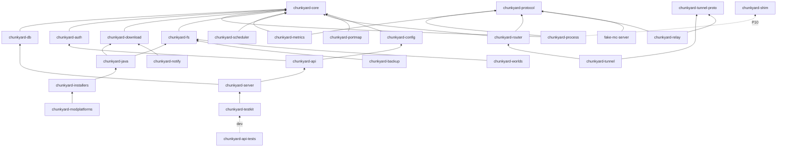

# Workspace layout

## Repository tree

```
.
├── Cargo.toml                 # [workspace], shared [workspace.dependencies], lints
├── rust-toolchain.toml        # channel = "stable" (MSRV recorded in Cargo.toml)
├── deny.toml                  # cargo-deny: licenses, advisories, bans
├── .sqlx/                     # sqlx offline query metadata (committed)
├── crates/
│   ├── chunkyard-core/              # domain types, ids, events, jobs, audit catalog, ALL cross-crate + repo traits
│   ├── chunkyard-config/            # composes per-crate config sub-structs; loading (file + env)
│   ├── chunkyard-db/                # sqlx pool, migrations/, Sqlite*Repo impls
│   ├── chunkyard-jobs/              # bounded persistent job execution, restart recovery
│   ├── chunkyard-auth/              # password hashing, sessions, TOTP, tokens, permission decisions
│   ├── chunkyard-protocol/          # LEAF: VarInt, SLP, handshake, RCON, Query, PROXY v2, log-line parsers
│   ├── chunkyard-download/          # SSRF-safe HTTP client, Downloader, content-addressed cache, Mojang profile client
│   ├── chunkyard-process/           # supervisor, spawner thread, stdio, log ring, platform module
│   ├── chunkyard-fs/                # sandboxed paths, file ops, archives, properties parser
│   ├── chunkyard-java/              # JRE discovery, Adoptium download, version → Java mapping
│   ├── chunkyard-installers/        # vanilla/paper/purpur/fabric/quilt/forge/neoforge/velocity/bungeecord/waterfall
│   ├── chunkyard-modplatforms/      # curseforge/modrinth/hangar clients + pack importers
│   ├── chunkyard-metrics/           # sampling, TPS probes, rollups
│   ├── chunkyard-backup/            # archive create/restore, retention, storage targets
│   ├── chunkyard-worlds/            # world discovery, upload/download, reset
│   ├── chunkyard-scheduler/         # cron engine, task step executor
│   ├── chunkyard-router/            # Minecraft hostname router (P7)
│   ├── chunkyard-portmap/           # UPnP IGD / NAT-PMP / PCP (P7)
│   ├── chunkyard-notify/            # Discord/webhook notifier (P8)
│   ├── chunkyard-tunnel-proto/      # LEAF: agent↔relay wire protocol (P9)
│   ├── chunkyard-tunnel/            # agent-side tunnel client (P9)
│   ├── chunkyard-relay/             # BINARY `chunkyard-relay` (P9)
│   ├── chunkyard-shim/              # BINARY `chunkyard-shim` + lib (shim socket protocol) (P10)
│   ├── chunkyard-api/               # axum routes, handlers, DTOs, OpenAPI, WS hub
│   ├── chunkyard-server/            # BINARY `mcm` + lib (`wiring`): composition root, SPA embedding, CLI
│   ├── chunkyard-node/              # primary↔agent RPC (P11, post-1.0)
│   ├── chunkyard-testkit/           # test helpers (dev-dependency only)
│   ├── chunkyard-api-tests/         # HTTP/WS integration tests only (publish = false, no lib code)
│   └── fake-mc-server/        # BINARY test fixture (dev/CI only, never shipped)
├── web/  e2e/  fuzz/  docker/  packaging/  xtask/  testdata/
└── specs/
```

## Crate responsibilities and dependencies

| Crate | Owns | May depend on (internal) | Notable external deps |
|---|---|---|---|
| `chunkyard-core` | IDs, domain models, `Event`, `Job`, `audit::Action` catalog, `ErrorKind`/`Classify`, `Clock`, **all repo traits** (`ServerRepo`, `JobRepo`, …) and **all cross-crate service traits** (`ServerService`, `ServerLookup`, `ServerCommandSink`, `CommandRunner`, `ProcessSpawner`, `PropertiesEditor`, `BackupService`, `RconExecutor`, `Downloader`, …) | — | serde, thiserror, uuid, time, tokio-util, async-trait |
| `chunkyard-config` | `Config` = composition of each crate's `*Config` sub-struct; loading, validation | core + every crate that exports a `*Config` | figment |
| `chunkyard-db` | Pool, migrations, `Sqlite*Repo` impls of core repo traits | core | sqlx |
| `chunkyard-jobs` | Bounded persistent job execution, restart recovery, shutdown | core | tokio, tokio-util |
| `chunkyard-auth` | `AuthService`, argon2, TOTP, token gen, `authorize()` | core | argon2, rand, totp-rs |
| `chunkyard-protocol` | Codecs + async clients: SLP, RCON, Query, handshake, PROXY v2; pure parsers `text::{log_prefix, list, tps, join_leave}` | — (leaf) | tokio (io), bytes, serde_json |
| `chunkyard-download` | `SafeHttp` (SSRF-safe resolver with IP pinning, shared by **every** outbound fetch), `HttpDownloader` (hash verify, resume, cache), Mojang profile client | core | reqwest, sha1, sha2 |
| `chunkyard-process` | `Supervisor` actor, `ServerHandle`, `LogRing`, spawner thread, `NativeSpawner`, `DockerSpawner` (P10), `ShimSpawner` (P10), `CommandRunner` impl, platform | core, protocol, shim (P10, lib only) | tokio, nix, bollard (P10) |
| `chunkyard-fs` | `SandboxRoot`, file ops, zip/tar, `.properties` & JSON list editors, trash | core | zip, tar, zstd, cap-std |
| `chunkyard-java` | `JavaRuntimeService`, Adoptium client, version → major mapping, `VersionMetaSource` trait | core, fs, download | — |
| `chunkyard-installers` | `Installer` trait + one module per flavour, `LaunchSpec`, run-script parser | core, fs, java, download | — |
| `chunkyard-modplatforms` | `ModPlatform` trait, CF/Modrinth/Hangar clients, pack importers | core, fs, installers, download | murmur2 |
| `chunkyard-metrics` | Collector, `TpsProbe` per flavour, rollups | core, protocol | sysinfo |
| `chunkyard-backup` | `BackupService` impl, `StorageTarget` (local, S3), retention | core, fs | object_store |
| `chunkyard-worlds` | `WorldService` impl | core, fs | — |
| `chunkyard-scheduler` | Cron engine, step executor | core | croner, chrono-tz |
| `chunkyard-router` | `McRouter`, synthetic responses, wake-on-join | core, protocol | — |
| `chunkyard-portmap` | `PortMapper` (UPnP/NAT-PMP/PCP), external IP classification | core | igd-next |
| `chunkyard-notify` | `Notifier`, Discord/webhook senders | core, download | hmac |
| `chunkyard-tunnel-proto` | Frames/codec for agent↔relay | — (leaf) | serde, postcard, bytes |
| `chunkyard-tunnel` | Tunnel client actor; hands data streams to `chunkyard-router`'s connection handler | core, tunnel-proto, router | rustls, yamux |
| `chunkyard-relay` | Relay binary | protocol, tunnel-proto | rustls, yamux, sqlx (own DB) |
| `chunkyard-shim` | Shim binary + client lib (unix-socket protocol) | — (leaf) | tokio |
| `chunkyard-api` | Router, handlers, DTOs, `ApiError`, OpenAPI, WS hub, `AppState` | core, auth, config (domain crates only for **types**, never constructing services) | axum, utoipa |
| `chunkyard-server` | `main`, `wiring::build_state`, SPA embed, CLI | everything | clap, rust-embed |
| `chunkyard-node` | Node RPC (post-1.0) | core, protocol | reqwest, tokio-tungstenite |
| `chunkyard-testkit` | `TestApp`, fakes, wiremock helpers, fake-mc launcher | core, db, server, protocol | wiremock, tempfile |
| `chunkyard-api-tests` | `tests/*.rs` only | dev: testkit, server, protocol | reqwest, tokio-tungstenite |
| `fake-mc-server` | Test fixture binary | protocol | clap |

## Dependency graph



(`chunkyard-config` → domain crates for `*Config` types and `chunkyard-server` → every crate are omitted from the graph for readability.)

## Rules (enforced in CI by `cargo xtask check-deps`)

1. **No cycles, no undeclared edges.** A crate may only depend on crates in its row. Adding an edge requires updating this file.
2. **Only `chunkyard-api` and `chunkyard-server` depend on `axum`, `tower`, `utoipa`.** DTOs with `ToSchema` live in `chunkyard-api::dto`.
3. **Leaves** (`chunkyard-protocol`, `chunkyard-tunnel-proto`, `chunkyard-shim`) depend on no `mcm-*` crate. They are exempt from the `Classify` rule ([patterns.md §1](patterns.md#1-errors)); consuming crates map leaf errors into their own error enums.
4. **Repo traits live in `chunkyard-core`.** Only `chunkyard-db` (and `chunkyard-relay`, for its own DB) depend on `sqlx`. No domain crate depends on `chunkyard-db`.
5. **Cross-area behaviour goes through `chunkyard-core` traits**, injected by `chunkyard-server::wiring`. Examples: scheduler → `BackupService`/`ServerService`; backup → `ServerCommandSink` (save-off/on) instead of `chunkyard-process`; metrics → `ServerLookup` + `RconExecutor` instead of `chunkyard-process`; router → `ServerService` (wake-on-join) + `PropertiesEditor`.
6. **Every external HTTP API sits behind a trait** in the consuming crate (`MojangApi`, `PaperApi`, `AdoptiumApi`, `CurseForgeApi`, …), built on `chunkyard_download::SafeHttp` with a configurable `base_url`.
7. **Config:** each crate defines its own `XxxConfig` (`Deserialize + Default`, `deny_unknown_fields`) and receives only that; `chunkyard-config` composes them. Domain crates never depend on `chunkyard-config`.
8. **No `anyhow` in library crates** (allowed in binaries' `main.rs`, `fake-mc-server`, tests).
9. **Test-only crates** (`chunkyard-testkit`, `chunkyard-api-tests`, `fake-mc-server`) are never normal dependencies of shipped binaries (`cargo tree -e normal -p chunkyard-server`). HTTP/WS integration tests live in `chunkyard-api-tests` so `chunkyard-api`/`chunkyard-server` need no dev-dependency on `chunkyard-testkit` (avoids the dev-dependency cycle and duplicate-crate type mismatches).
10. Workspace lints: `unsafe_code = "deny"` (exceptions with `// SAFETY:` only in `chunkyard-process::platform`), `clippy::unwrap_used = "deny"` outside tests, `missing_docs = "warn"`.

## Feature flags

| Crate | Feature | Default | Effect |
|---|---|---|---|
| `chunkyard-server` | `embed-ui` | on | Embed `web/build` (off for the Vite dev loop, see [frontend.md](frontend.md#embedding-and-dev-loop)) |
| `chunkyard-server` | `test-hooks` | **off; never enabled in release builds** | Upstream base-URL overrides, debug/no-op job route, fake clock injection. CI release job asserts the feature is absent (`mcm version --features`) |
| `chunkyard-backup` | `s3` | on | `object_store/aws` |
| `chunkyard-process` | `docker` | off until P10 | `DockerSpawner` via `bollard` |
| `chunkyard-portmap` | `upnp` | on | `igd-next` |

## Build outputs

- `mcm`, `chunkyard-relay`, `chunkyard-shim` — static musl binaries for x86_64 and aarch64.
- OCI image `ghcr.io/<org>/mcm` (debian-slim base because Adoptium JREs are glibc-linked; see [process-model.md](process-model.md#java-runtimes-and-libc)).

Current implementation note: Docker lifecycle is being implemented ahead of native/shim runtimes. The initial managed-JAR API and its limits are documented in `docs/docker.md`; the complete P1/P10 specs remain future targets.
