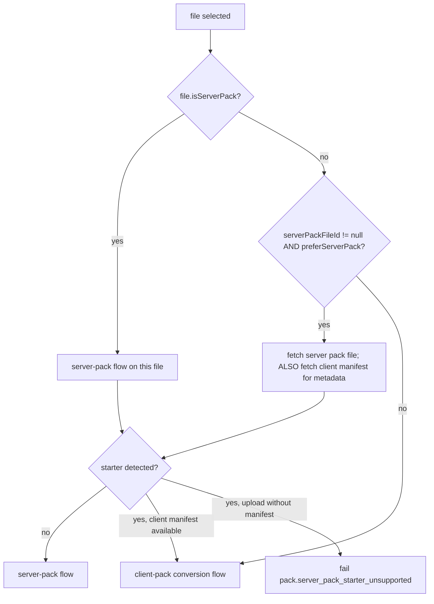

# Phase 4 — Pack import pipeline

Implemented in `chunkyard-modplatforms::pack`. Pure planning is separated from I/O so most logic is unit-testable.

## Stages (job progress)

| # | Stage | Weight | Output |
|---|---|---|---|
| 1 | `resolve` | 5 % | Pack source: API file/version metadata or uploaded archive; kind = `cf_server`, `cf_client`, `mrpack` |
| 2 | `fetch_pack` | 15 % | Pack archive in download cache (hash-verified) |
| 3 | `plan` | 10 % | `ImportPlan` (below), persisted to `pack_imports.plan` |
| 4 | `install_loader` | 20 % | Loader + MC server installed via phase-3 `Installer`; `LaunchSpec` set |
| 5 | `download_files` | 35 % | Direct files downloaded in parallel (6 concurrent, per-host max 4), hard-linked from cache |
| 6 | `apply_overrides` | 10 % | `overrides/` (+ `server-overrides/`) extracted via `chunkyard-fs` |
| 7 | `detect_client_only` | 3 % | Suspects renamed to `.disabled` |
| 8 | `record` | 2 % | `installed_content` rows, `pending_manual_downloads` rows, import report in `<data>/state/<id>/install.log` |

Stage names are emitted in `job.message` as `"<stage>: <detail>"`; progress is the weighted sum.

## ImportPlan

```rust
pub struct ImportPlan {
    pub kind: PackKind,                 // CfServer | CfClient | Mrpack
    pub pack: PackIdentity,             // platform, project id, version id, name, version string
    pub mc_version: McVersion,
    pub loader: Option<LoaderSpec>,     // { kind: Forge|NeoForge|Fabric|Quilt, version }
    pub java_major: u8,                 // from phase-3 mapping
    pub files: Vec<PlannedFile>,        // path, source (Direct{url}|Manual{website}|InArchive), size, hashes, side, optional
    pub suspected_client_only: Vec<SuspectReport>,
    pub warnings: Vec<PlanWarning>,     // missing files, duplicate paths, scripts found, stale server pack, etc.
    pub total_download_bytes: u64,
}
```

`plan(...)` is a pure function of (manifest/index, resolved metadata, archive listing) → `ImportPlan`; all tests of decision logic target it.

## Flow selection (CurseForge)



When the server pack is used, the client pack's `manifest.json` (downloaded in parallel, small) supplies authoritative MC version + loader; detection from the server-pack contents is the fallback (packs uploaded without API context).

## Starter detection

`pack::starter::classify(listing, script_contents, client_manifest) -> StarterVerdict` (pure). Inputs come from the extracted listing; scripts are read (≤ 256 KiB each) but **never executed**.

| Signal | Rule | Verdict |
|---|---|---|
| ServerStarter | `server-setup-config.yaml` at pack root (after top-level strip) | starter |
| Installer script | Top-level `*.sh`/`*.bat`/`*.ps1` matching any marker: `curl `, `wget `, `Invoke-WebRequest`, `serverstarter`, `-jar\s+\S*installer\S*\.jar`, `--installServer`, `fabric-installer`, `quilt-installer` | starter |
| Forge-generated `run.sh`/`run.bat` | Only `java @user_jvm_args.txt @libraries/…` (+ comments) | **not** a signal |
| Near-empty mods | `mods/` has < 3 `.jar` files while the client manifest lists ≥ 10 required files | starter |

Verdict `starter` + client manifest → switch to client-pack conversion, add `pack.server_pack_starter_fallback` warning naming the triggering signal(s). Verdict `starter` without a manifest (uploaded zip) → `pack.server_pack_starter_unsupported`.

Fixture: `CfServerPackBuilder::server_starter()` (in `chunkyard-testkit::packs`) synthesises a ServerStarter-style zip: `server-setup-config.yaml`, `startserver.sh` with `curl`/`java -jar serverstarter-2.4.0.jar`, `serverstarter-2.4.0.jar` stub, empty `mods/`, `config/`.

## Untrusted metadata

`pack::untrusted` wraps every parser: byte caps (manifest/index ≤ 8 MiB, properties ≤ 1 MiB, script read ≤ 256 KiB), `RelPath` for every path, unknown fields ignored, no `LaunchSpec::Custom`, no Java paths. The pack's `server.properties` is merged through the phase-2 properties editor so managed/secret keys are never taken from the pack.

## Loader detection

Applied to an extracted server pack, in order; first match wins:

| # | Signal | Result |
|---|---|---|
| 1 | Client `manifest.json` `minecraft.version` + primary `modLoaders[].id` | authoritative |
| 2 | `variables.txt` (ServerPackCreator): `MINECRAFT_VERSION`, `MODLOADER`, `MODLOADER_VERSION` | loader + versions |
| 3 | `libraries/net/neoforged/neoforge/<ver>/` | NeoForge `<ver>`; MC from `21.1.x` → `1.21.1` mapping (phase 3) |
| 4 | `libraries/net/minecraftforge/forge/<mc>-<ver>/` or `forge-<mc>-<ver>-installer.jar` / `forge-<mc>-<ver>(-universal)?.jar` | Forge |
| 5 | `neoforge-<ver>-installer.jar` | NeoForge |
| 6 | `fabric-server-launch.jar` + `.fabric/server/` or `fabric-server-launcher.properties` | Fabric; loader version from jar manifest / `mods/` fabric-loader if present, else latest stable for MC (warning) |
| 7 | `quilt-server-launch.jar` | Quilt (same fallback) |
| 8 | Only `server.jar` + `mods/` | Unknown → `pack.unsupported_loader` with hint to choose loader manually (`loaderOverride` in request) |

MC version fallback: `version.json` inside `server.jar`/`minecraft_server.*.jar` name pattern.

## Client-only detection algorithm

```
for each jar in plan (and later every jar placed by manual uploads):
  signals = []
  if cf.gameVersions ∋ "Client" and ∌ "Server": signals += Strong("cf_env_client")
  if modrinth.lookup(sha1).project.server_side == "unsupported": signals += Strong("modrinth_server_unsupported")
  if jarmeta.environment == Client: signals += Strong("jar_environment_client")
  if denylist ∋ (modId | cf project id | modrinth project id): signals += Strong("denylist")
  if forge displayTest == IGNORE_ALL_VERSION: signals += Weak("forge_display_test")
  if any Strong and no "modrinth server_side in {required, optional}" override: suspect
```

Modrinth lookup is batched (`POST /v2/version_files`, ≤ 1000 hashes per call — verify limit). A Modrinth positive server-side classification **overrides** CF env tags and the denylist (authors' explicit metadata wins), but not `jar_environment_client`.

Bundled denylist `data/client_only_denylist.toml` (maintained data, reviewed each release) — initial entries are well-known client-only mods, e.g. Iris, Sodium, Oculus, Embeddium, Rubidium, OptiFine, Xaero's Minimap, Xaero's World Map, Mod Menu, Controlling, Mouse Tweaks, Ambient Sounds, Dynamic Lights variants, Entity Culling (client-only on Forge, verify), Not Enough Animations, Legendary Tooltips. Each entry: `mod_id`, optional `curseforge_id`, `modrinth_id`, `note`. Mods with an optional server component (e.g. JourneyMap, Simple Voice Chat) must **not** be listed — the list needs care and every addition requires a note with evidence.

## Job model for manual downloads

**Decision:** no new job state. `pack.import` ends `succeeded` with `result = { status: "needs_manual_downloads", pending: n }`; resolution happens through normal API calls; `pack.finalize` is a separate short job.

| Alternative | Rejected because |
|---|---|
| New `waiting_for_user` job state | Requires rebuilding the `jobs` table CHECK constraint; a job could wait for days holding a cancellation token and the per-server "one mutating job" lock (blocking backups/settings); phase-0 restart rule would fail it on every mcm restart |
| `failed` with code | Misleading; everything that could be done succeeded |

State lives in `pack_imports.state`: `importing → needs_manual → finalizing → complete` (or `failed`/`cancelled`). Server start is gated on `pack_imports.state != needs_manual` (`409 pack.pending_downloads`, overridable with `force`).

## Overrides

- CF client pack: directory name from `manifest.overrides` (default `"overrides"`).
- mrpack: `overrides/` then `server-overrides/`; `client-overrides/` ignored.
- Extraction never overwrites `server.properties` keys managed by mcm (merge as in requirements edge cases) and never writes `eula.txt`. mcm state is outside the server dir (`<data>/state/<id>/`), so pack contents cannot reach it.

## Post-import report

`<data>/state/<id>/install.log` and `pack_imports.report` (JSON) contain: pack identity, flow used (incl. starter fallback), loader, counts (installed/skipped/manual/suspected), warnings, list of inert scripts found. Shown in UI after import.
