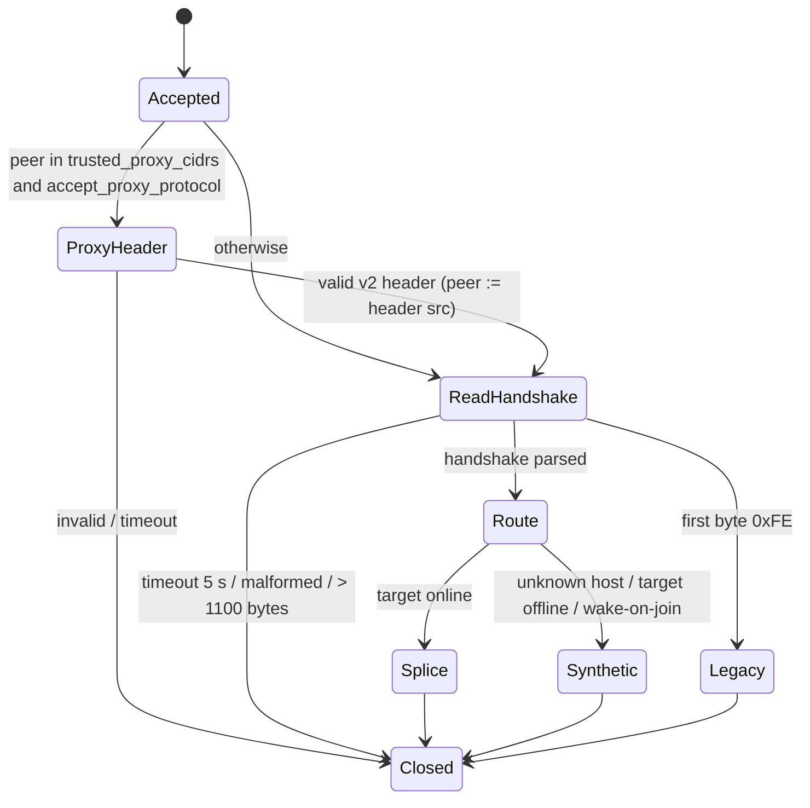

# Phase 7 — Hostname router (`chunkyard-router`)

## Structure

```
crates/router/src/
├── lib.rs
├── router.rs            # McRouter actor: listener, accept loop, limits, route table (watch::Receiver<RouteTable>)
├── conn.rs              # per-connection state machine (transport-agnostic: IncomingConn) — public ConnectionHandler
├── route_table.rs       # hostname → RouteTarget lookup, exact + wildcard
├── responses.rs         # synthetic status JSON, login disconnect, legacy kick
├── backend_config.rs    # Paper PROXY setting helper (via core ServerFileAccess)
├── validate.rs          # route validation incl. PROXY ⇒ router_only (pure)
├── exposure.rs          # exposure summary + warnings; impl of core ServerNetworkInfo
└── config.rs            # RouterConfig ([router] section)
crates/protocol/src/
├── handshake.rs         # parse + normalize_host (shared with chunkyard-relay)
├── legacy.rs            # 0xFE / 0xFF legacy ping
└── proxy_v2.rs          # PROXY v2 encode/decode incl. LOCAL (pure)
```

`IncomingConn { stream: Box<dyn AsyncReadWrite>, peer: SocketAddr, local: SocketAddr, prebuffered: Bytes, hostname_hint: Option<String> }` is produced by the TCP listener and, from P9, by `chunkyard-tunnel`, which calls the public `ConnectionHandler`; routing, wake-on-join and PROXY emission are implemented once.

## Connection state machine



## Handshake handling

1. Read bytes into a buffer until one full frame is available: VarInt length (≤ 3 bytes, value ≤ 1100) + body. Deadline 5 s from accept (`handshake_timeout_s`).
2. Parse with `mcm_protocol::handshake::parse` ([minecraft-protocols.md § Handshake](../../architecture/minecraft-protocols.md#handshake-state-handshaking-id-0x00)): packet id must be `0x00`; next state ∈ {1, 2, 3}; else close.
3. Normalise hostname: take bytes before first `\0` (drops `FML`/`FML2`/`FML3` markers and forwarding payloads), strip trailing `.`, strip `:port` if present, lowercase ASCII, IDNA not decoded (punycode compared as-is). Empty → treated as unknown host.
4. **Keep the original bytes** (all bytes read so far, which may include the following Status Request or Login Start packet). These are replayed verbatim to the backend; the router never re-encodes the handshake (preserves Forge markers the backend needs).

## Route lookup

`RouteTable` built from enabled `proxy_routes` rows (+ fallback):

| Order | Match |
|---|---|
| 1 | Exact hostname (`survival.example.com`) |
| 2 | Wildcard suffix, longest first (`*.example.com` matches `a.example.com`, not `example.com`, not `a.b.example.com` — single label only) |
| 3 | Fallback route (setting `router.default_server_id`), if set |
| 4 | Unknown host → synthetic response |

Route target = `127.0.0.1:<servers.port>` (backend always local; P10 Docker publishes on loopback; post-1.0 P11 may extend to node addresses). Table is swapped atomically (`watch`) on route/server changes; existing connections unaffected.

## Splice

1. Connect to backend (timeout 3 s). Failure → synthetic "offline" response (state 1) or disconnect "Server unavailable" (state 2/3).
2. If `route.send_proxy_protocol`: write PROXY v2 header (below) first.
3. Write prebuffered bytes.
4. `tokio::io::copy_bidirectional_with_sizes(client, backend, 16 KiB, 16 KiB)` wrapped with an idle timeout: if neither direction moves bytes for `idle_timeout_s` (default 120; Minecraft keep-alives are every ~15 s, so idle means dead), both sides are shut down.
5. On end, increment per-route counters: connections, bytes in/out, current active (gauge).

Half-close: when one side sends FIN, shut down write of the other side, keep reading until both closed or idle timeout.

## Synthetic responses

| Situation | next state 1 (status) | next state 2/3 (login/transfer) |
|---|---|---|
| Unknown host | Status JSON: `version.name = "mcm"`, `version.protocol` = **client's protocol** (so the client does not show "outdated"), players 0/0, `description` = setting `router.unknown_host_motd` (default "§cUnknown server address"); answer Ping with Pong | Login Disconnect `0x00` with JSON text component `{"text":"Unknown server address <host>"}` |
| Target stopped, wake-on-join off | MOTD `router.offline_motd` (default "§7Server is offline") | Disconnect "Server is offline" |
| Target stopped, wake-on-join on | MOTD "§eServer is sleeping — join to start it" | Trigger start (below), disconnect "Server is starting, try again in about a minute" |
| Target `Starting` | MOTD "§eServer is starting…" | Disconnect "Server is starting, try again shortly" |

Status JSON max 32 KiB; strings are JSON-escaped (MOTD from settings may contain `§` codes but is not interpreted as JSON). The router only sends text components it builds itself — no user-provided JSON components (avoids click-event injection).

Legacy `0xFE` ping: if a fallback route exists and it is running, splice the bytes; otherwise reply `0xFF` kick with the legacy format and close.

## Wake-on-join (`route.wake_on_join`)

- Only on next state 2 (a real join attempt), never on status pings (server lists ping constantly).
- Calls `ServerService::start(server_id, Actor::System("router"))`; audit action `server.start` with `details.trigger = "wake_on_join"` and the client IP.
- Rate limit: at most one start trigger per server per 60 s and per client IP per 5 min; a server in `Crashed` crash-loop state or `maintenance` is not started.
- Optional `sleep_after_idle_min` is **not** part of P7 (candidate for later using P5 player data).

## Inbound PROXY v2

- Setting `router.accept_proxy_protocol` (bool) and config `[router] trusted_proxy_cidrs` (list). When enabled, connections from trusted CIDRs **must** start with a v2 header (5 s timeout); connections from other peers must not (a header from an untrusted peer → close, prevents spoofing).
- Command `LOCAL` (health checks) → treat as no address info, peer stays the socket address.
- Tunnel connections (P9) carry the client address in `StreamOpen` and never parse PROXY headers.

## PROXY protocol v2 encoding

Implemented in `mcm_protocol::proxy_v2` (leaf crate, pure).

| Offset | Bytes | Value |
|---|---|---|
| 0 | 12 | Signature `0D 0A 0D 0A 00 0D 0A 51 55 49 54 0A` |
| 12 | 1 | `0x21` = version 2 (high nibble) + command PROXY (low nibble `1`); `0x20` = LOCAL |
| 13 | 1 | `0x11` TCP over IPv4, `0x21` TCP over IPv6 |
| 14 | 2 | Length of the rest, big-endian |
| 16 | 12 / 36 | IPv4: src addr(4) dst addr(4) src port(2) dst port(2). IPv6: 16 + 16 + 2 + 2. All big-endian |
| … | var | Optional TLVs: we send `PP2_TYPE_AUTHORITY` (`0x02`) = normalised hostname (≤ 255 bytes) |

Rules: IPv4-mapped IPv6 (`::ffff:a.b.c.d`) source is converted to IPv4; if source and destination families differ after conversion, both are encoded as IPv6 (v4 mapped). Destination = the address/port the client connected to (router listener; relay public address in P9). Decoder accepts and ignores unknown TLVs, rejects length > 536 bytes (no TLVs beyond 255-byte authority + CRC/other small TLVs needed) and any version ≠ 2.

### `LOCAL` header for mcm's own probes (P7-FR-17)

Once a backend expects PROXY, it rejects connections without a header — including mcm's own SLP probes. Every chunkyard-originated connection to such a backend (route health, P1 ready fallback, P5 SLP fallback) first sends the fixed 16-byte `LOCAL` header:

```
0D 0A 0D 0A 00 0D 0A 51 55 49 54 0A   20   00   00 00
signature                             ver2/LOCAL  fam UNSPEC  len 0
```

Callers ask `ServerNetworkInfo::backend_expects_proxy(server_id)` (core trait, impl in `chunkyard-router`) and pass `SlpOptions { proxy_v2_local: true }`. The backend then uses the socket address (loopback) for the probe.

## Backend configuration helpers (`backend_config.rs`)

Enabling `send_proxy_protocol` on a route **breaks direct connections** to that backend (it expects a header from everyone). Therefore all routes of a PROXY server must be `router_only` (P7-FR-18, `proxy.proxy_protocol_requires_router_only`).

| Flavor | Action when the route enables PROXY |
|---|---|
| paper, purpur | mcm sets `proxies.proxy-protocol: true` in `config/paper-global.yml` (key path to verify) through core `ServerFileAccess` (impl `chunkyard-fs`, sandboxed). If the file does not exist yet (never started), the change is applied after first start creates it, and the route shows "pending backend config". Edit is a YAML load/modify/dump (`serde_yaml`); comments lost are regenerated by Paper on next start. Restart required. |
| velocity | Guidance text only: `haproxy-protocol = true` in `velocity.toml`. |
| bungeecord, waterfall | Guidance text only: `proxy_protocol: true` on the listener in `config.yml`. |
| vanilla, fabric, quilt, forge, neoforge | No built-in support: toggle is allowed but shows a blocking warning "this server cannot read PROXY headers without a mod; players will fail to connect". |

## Loopback-only exposure

Route option `exposure`: `router_only` (default for new routes) or `direct_and_router`. With `router_only`, mcm sets `server-ip=127.0.0.1` in `server.properties` via core `PropertiesEditor` before each start (managed key; P2 marks it read-only in the editor), which also keeps RCON on loopback. Removing the last router-only route restores the previous `server-ip` value (stored in `proxy_routes.previous_server_ip`).

## Limits

| `[router]` key | Default |
|---|---|
| `max_connections` | 2 000 total |
| `max_connections_per_ip` | 16 concurrent |
| `connection_rate_per_ip` | 30 / minute (token bucket) |
| `handshake_timeout_s` | 5 |
| `idle_timeout_s` | 120 |

Exceeded limits close the socket immediately without a response (cheap under flood). Counters `rejected_rate`, `rejected_limit`, `bad_handshake` exposed in router status.

## Real-IP warning (P7-FR-19)

Without PROXY, every routed player appears as `127.0.0.1` to the backend. `exposure.rs` attaches `real_ip_hidden` to such routes and downgrades the router exposure entry to `warning`; the UI repeats it on the Network tab and the P5 players page. P2 blocks `ban-ip` of loopback addresses so an operator cannot ban everyone by accident ([security.md](../../architecture/security.md#player-ip-integrity)).
