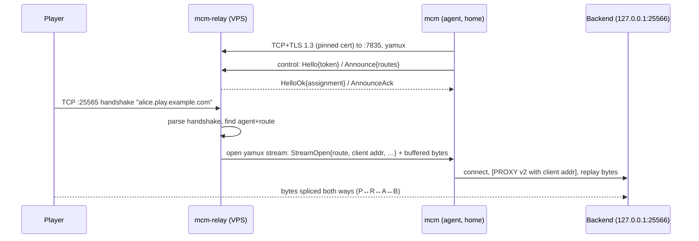

# Phase 9 — Relay design (`mcm-relay`, `mcm-tunnel`)

## Topology



## Transport decision: TLS 1.3 over TCP + yamux

| Option | Pros | Cons | Decision |
|---|---|---|---|
| **TLS/TCP + yamux** | One outbound TCP connection works through every firewall/proxy that allows HTTPS-like traffic; game traffic is TCP anyway; mature rustls; simple to reason about backpressure (yamux windows) | Head-of-line blocking across streams on packet loss | **Chosen** |
| QUIC (quinn) | No HOL blocking, connection migration, datagrams (future Bedrock) | UDP often blocked/throttled on corporate/hotel networks; more tuning | Later option behind the same `Transport` trait |
| One TCP conn per player (frp-style) | No multiplexing | Relay must ask agent to dial back per player (latency, connection storms) | Rejected |

Yamux settings: initial stream window 256 KiB, max 2 048 streams per agent, keep-alive handled by our control Ping (yamux's own disabled).

## Relay binary

```
mcm-relay init --public-host relay.example.com [--data-dir /var/lib/mcm-relay]
    # creates relay.toml, relay.db, self-signed ECDSA P-256 cert (rcgen, SAN=public host, 10y), admin token
mcm-relay serve
mcm-relay agent add --name alice --hostnames 'alice.play.example.com,*.alice.play.example.com' [--ports 25570,25571] [--max-streams 256] [--bandwidth-mbps 50]
    # prints pairing string once
mcm-relay agent list | agent revoke <name> | agent rotate-token <name> | agent set <name> --hostnames … --ports …
mcm-relay status            # queries the running relay's admin socket
```

Pairing string (parsed by `mcm_tunnel_proto::pairing`): `mcmrelay://relay.example.com:7835?fp=sha256:<64 hex of DER leaf cert>&token=mcr_<32 base62>&name=alice`. If the operator configures a CA-issued cert (`tls.cert`/`tls.key` in relay.toml), `fp` is omitted and mcm validates with webpki roots + hostname.

### `relay.toml`

```toml
data_dir = "/var/lib/mcm-relay"
tunnel_listen = "0.0.0.0:7835"
public_listen = ["0.0.0.0:25565", "[::]:25565"]   # shared hostname-routed listeners
dedicated_port_range = [25570, 25670]           # ports assignable to agents (listened on demand)
admin_socket = "/run/mcm-relay/admin.sock"       # CLI ↔ daemon (mode 0600)
admin_http = ""                                  # optional "127.0.0.1:7836", bearer admin token, GET /status, GET /metrics
offline_motd = "§7This server is offline"
[tls]  # optional CA cert; default self-signed from init
[limits]
handshake_timeout_s = 5
max_conns_per_ip = 16
conn_rate_per_ip_per_min = 30
max_agents = 100
```

### State: SQLite `relay.db` (own sqlx migrations in `crates/mcm-relay/migrations/`)

```sql
CREATE TABLE agents (id TEXT PRIMARY KEY, name TEXT NOT NULL UNIQUE, token_hash BLOB NOT NULL UNIQUE,
  hostnames TEXT NOT NULL, ports TEXT NOT NULL, max_streams INTEGER NOT NULL DEFAULT 256,
  bandwidth_mbps INTEGER, revoked_at INTEGER, created_at INTEGER NOT NULL, last_seen_at INTEGER);
CREATE TABLE agent_stats (agent_id TEXT NOT NULL, day TEXT NOT NULL, connections INTEGER NOT NULL,
  bytes_in INTEGER NOT NULL, bytes_out INTEGER NOT NULL, PRIMARY KEY (agent_id, day));
```

SQLite (not TOML) because the CLI mutates agents while the daemon runs; the CLI writes through the admin socket when the daemon is up (daemon applies immediately, e.g. disconnects revoked agents) and directly to the DB when it is not.

## Agent authentication

1. Agent connects TCP → TLS. Certificate check: custom rustls `ServerCertVerifier` comparing `sha256(leaf DER)` to the pinned fingerprint in constant time, **while still verifying handshake signatures** (delegating `verify_tls13_signature` to the default provider). Mismatch → `relay.fingerprint_mismatch`, no retry until user re-pairs.
2. Agent opens yamux stream 1 (control) and sends `Hello { token, … }` ([tunnel-protocol.md](tunnel-protocol.md)).
3. Relay looks up `sha256(token)`; unknown or revoked → `HelloErr{code:"auth"}` and close; 5 failures per IP per minute → IP blocked 10 min.
4. One active session per agent: a new successful Hello disconnects the old session (`GoAway{reason:"replaced"}`).
5. Tokens never logged; stored hashed on the relay and encrypted (`token_enc`) in mcm.

## Routing on the relay

| Listener | How the agent/route is chosen |
|---|---|
| Shared (`public_listen`) | Parse handshake exactly like the P7 router (same `mcm_protocol::handshake` code and `normalize_host`). Hostname must match an **announced** route whose hostname is within that agent's **assigned** hostnames (exact or `*.` single-label wildcard). |
| Dedicated port | Port → agent assignment; route = the route announced for that port. No handshake parsing needed (bytes forwarded raw; `hostname = None`). |

No live agent/route: status → `offline_motd` with client's protocol echoed; login → disconnect "Server is offline". Never forwards anywhere except into an authenticated tunnel, so the relay is **not an open proxy**.

Per-player: relay opens a yamux stream to the agent, writes `StreamOpen` then the buffered bytes, then splices. Relay-side limits: per-IP concurrent and rate limits, per-agent `max_streams` (excess → disconnect "Server is full"), optional per-agent bandwidth token bucket.

## Agent side (`mcm-tunnel`)

- `TunnelClient` actor (crate `mcm-tunnel`, depends on `mcm-core`, `mcm-tunnel-proto`, `mcm-router`) per enabled `relay_connections` row: connect → Hello → Announce routes (from `proxy_routes` where `relay_id` = this relay) → serve streams. Re-announces on route changes.
- Reconnect backoff 1 s → 60 s with jitter; reset after 60 s connected. Status published on bus (`RelayStatusChanged`).
- Each incoming stream → `IncomingConn { peer: StreamOpen.client_addr, hostname_hint, prebuffered }` → `mcm_router::ConnectionHandler` ([P7 router](../07-network-exposure/router.md); route lookup by `route_key`, wake-on-join, PROXY v2 to backend with the real client address if the route wants it, splice). The router listener itself need not be enabled.
- Heartbeat: `Ping` every `[relay_client] heartbeat_s` (15 s); no `Pong` within 3 × heartbeat → reconnect.
- Pairing-string parsing lives in `mcm_tunnel_proto::pairing` (shared by the relay CLI and mcm).
- Real IP: relay routes **without** PROXY to the backend hide player IPs exactly like the P7 router; the same `real_ip_hidden` warning applies (security.md T13).

## DNS guidance (docs)

| Need | Record |
|---|---|
| Shared hostname routing | `*.play.example.com A <relay IPv4>` and `AAAA <relay IPv6>` (wildcard) or one record per hostname |
| Dedicated port without typing the port | `_minecraft._tcp.alice.play.example.com SRV 0 5 25570 relay.example.com.` (Java clients honour SRV; Bedrock does not) |
| Tunnel endpoint | `relay.example.com A/AAAA` |

Firewall on VPS: open TCP 7835, 25565, and the dedicated range.

## Alternatives to `mcm-relay`

mcm documents these in the "Behind CGNAT" docs page and links to them from the Relays empty state. They work with mcm today because they forward plain TCP to the router port or a server port.

| Option | Self-hosted? | Real client IP to backend | UDP / Bedrock | Cost | Setup complexity |
|---|---|---|---|---|---|
| **mcm-relay** (this phase) | Yes (any VPS) | Yes (PROXY v2 from agent) | No (future QUIC) | VPS (~€4/mo) | Low: `init`, `agent add`, paste pairing string |
| **frp** (`frps` on VPS, `frpc` at home) | Yes | Yes, `proxy_protocol_version = "v2"` on the TCP proxy | Yes (UDP proxies) | VPS | Medium: two config files, token, ports per server; no hostname routing for Minecraft (point frp at the mcm router port to get it) |
| **playit.gg** | No (hosted; agent at home) | Supported via PROXY protocol option (to verify current plan limits) | Yes (Bedrock supported) | Free tier / paid for custom domains & dedicated IPs | Low: agent + web dashboard; third party sees all traffic metadata |
| **WireGuard to a VPS** + DNAT (`iptables`/`nftables`) or the mcm router running on the VPS | Yes | With DNAT, the backend sees the real IP only if the VPS routes return traffic through the tunnel (policy routing); else use PROXY from an HAProxy/mcm router on the VPS | Yes (DNAT any port) | VPS | High: kernel networking, routing tables, firewall |
| **Tailscale Funnel** | No (hosted) | No | No | Free/paid | Low, but Funnel only exposes ports 443/8443/10000 and is designed for HTTPS/TLS; raw Minecraft TCP is not a supported use (to verify) — use Tailscale only for private player access via the tailnet |

Why mcm ships its own relay anyway: zero extra config files (pairing string from the UI), hostname routing on one shared port for many servers and many agents, real client IP by default, routes managed from the same UI with health/status, revocable per-agent tokens, and no third party in the traffic path. Users who already run frp or playit can ignore P9 entirely.

## Future work

- QUIC transport (quinn) behind `Transport` trait; QUIC datagrams to carry Bedrock/UDP (Geyser) traffic.
- ACME certificates for the tunnel endpoint.
- Multiple relays per route for failover.
- Relay web dashboard.
