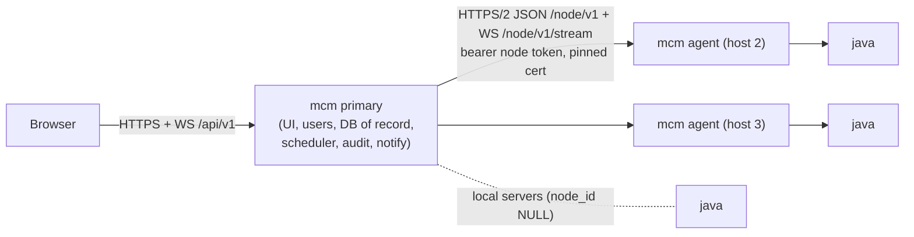

# Phase 10 — Multi-node

## Goal

One web panel controlling servers on several machines. The same `mcm` binary runs either as a **primary** (UI, users, scheduling, audit — today's mode) or as an **agent** (`mcm agent`: no UI, no users; owns processes, files, local backups, metric sampling on its host). The API seen by browsers does not change: service traits gain remote implementations routed by `servers.node_id`.

## Topology

## Key decisions

| Decision | Choice | Why |
|---|---|---|
| Connection direction | **Primary → agent** (agent listens on `agent.listen`, default `0.0.0.0:8421`) | Plain HTTPS, debuggable with curl; agents are typically on the same LAN/VPN. Agent-initiated (NAT traversal) mode is an open question; the relay (phase 7) or a VPN covers NAT today |
| RPC | **HTTP/2 + JSON** (reqwest ↔ axum, rustls) for request/response, **one WebSocket per node** (`/node/v1/stream`) for status, console, metrics, job progress | Reuses serde domain DTOs and utoipa (a separate `node-openapi.json`); no protobuf toolchain or second schema system (gRPC/tonic rejected for that reason); WS envelope mirrors the browser envelope so the hub logic is shared |
| Auth | Agent generates a self-signed TLS cert + node token at `mcm agent init`; prints a **pairing string** `mcmnode://<host>:8421?fp=sha256:<hex>&token=mcmn_<32 base62>`. Primary pins the cert fingerprint; agent checks `Authorization: Bearer` (sha256-hashed at rest) and binds to the first primary's `instance_id` | Same pairing pattern as the relay (phase 7c): no CA to run, mutual authentication (agent proven by pinned key, primary by token) |
| Source of truth | Primary DB for config; agent keeps a **local copy of each server's `ServerSpec`** (with `config_rev`) so auto-start and crash restarts work while the primary is down | Machines reboot independently; the agent must not depend on the primary for lifecycle |
| Metrics | Agent samples; streams to primary; buffers ≤ 1 h while disconnected and backfills | Primary keeps one history store |
| Scheduler | Runs on primary only; dispatches steps to the node | One place for cron, audit, notifications |

## Scope

Agent mode, node enrollment/rotation/removal, node health and offline semantics, remote implementations of server/console/files/java/installers/content/backup/metrics services, job mirroring, file streaming through the primary, server migration between nodes, per-node port allocation, version-skew policy, UI for nodes and node selection.

## Non-goals

- High availability or replication of the primary; automatic failover of servers to other nodes.
- Automatic placement/scheduling (admin picks the node; UI shows free memory as a hint).
- Agent-to-agent direct transfers (migration goes through the primary).
- Agent-initiated (reverse) connections — open question.
- Running the router/relay client on agents: router and relay tunnel stay on the primary and dial node addresses.

## User stories

| ID | Story |
|---|---|
| US-10.1 | As an admin, I add my second machine as a node by pasting a pairing string. |
| US-10.2 | As an admin, I create a server and choose which node it runs on. |
| US-10.3 | As a user, I use console, files and settings for a remote server exactly like a local one. |
| US-10.4 | As an admin, when a node goes offline I see it clearly and its servers keep running; actions resume when it returns. |
| US-10.5 | As an admin, I move a server from one node to another. |
| US-10.6 | As an admin, I upgrade nodes one by one without breaking the panel. |

## Dependencies

All of phases 0–9: every service trait introduced there gets a remote implementation. Specifically [00-foundation](../00-foundation/README.md) (jobs, auth), [01-lifecycle-console](../01-lifecycle-console/README.md) (supervisor, console), [02-settings-files](../02-settings-files/README.md) (files), [03-java-installers](../03-java-installers/README.md), [04-modpacks-content](../04-modpacks-content/README.md), [05-monitoring](../05-monitoring/README.md), [06-backups-scheduler-worlds](../06-backups-scheduler-worlds/README.md), [07-network-exposure](../07-network-exposure/README.md), [08-users-audit-notifications](../08-users-audit-notifications/README.md), [10-isolation-limits](../10-isolation-limits/README.md).

## New crate

`crates/mcm-node` — node protocol DTOs, `NodeClient` (reqwest + tokio-tungstenite), and `Remote*Service` implementations of the `mcm-core` service traits. Depends on `mcm-core` only (+ external). Agent-side axum routes live in `mcm-api::node` (the HTTP-layer rule holds). **Requires adding the crate to [workspace-layout.md](../../architecture/workspace-layout.md).**

## Documents

[requirements](requirements.md) · [api](api.md) · [ui](ui.md) · [tests](tests.md)

## Exit checklist

- [ ] All `P11-FR-*` implemented with passing tests.
- [ ] The phase 1 lifecycle, phase 2 files, and phase 6 backup API suites run **parameterised over local and remote servers** (`TestCluster` with primary + 2 agents in-process) and pass unchanged.
- [ ] Node offline/online cycle covered: servers keep running on the agent, primary shows `unknown`, actions return `503 node.offline`, state reconciles on reconnect.
- [ ] Migration job moves a server with world data and preserves content hash.
- [ ] Version-skew matrix test (N, N-1, N-2 agents) passes.
- [ ] `no_secrets_in_logs` covers node tokens and forwarded S3 credentials.
- [ ] E2E: add node, create remote server, console, files, migrate.
