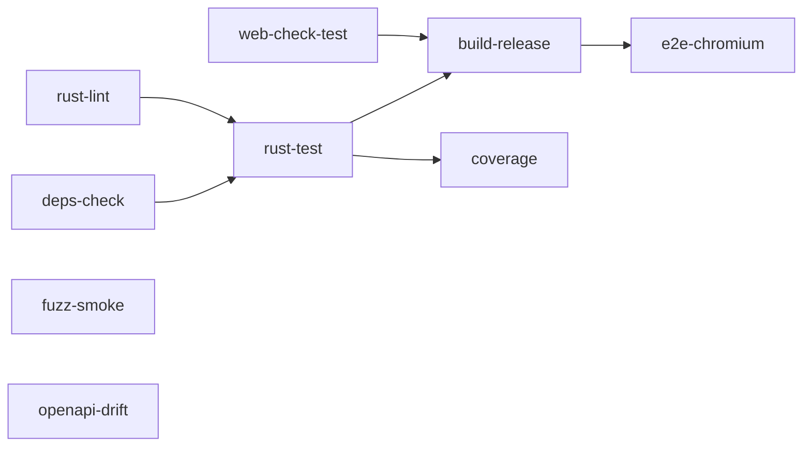

# CI pipeline

GitHub Actions syntax is used below; the job graph is what matters and ports to Gitea/Forgejo Actions unchanged.

## Job graph

## Jobs (on every push / PR)

| Job | Steps | Gate |
|---|---|---|
| `rust-lint` | `cargo fmt --check`; `cargo clippy --workspace --all-targets -- -D warnings`; `SQLX_OFFLINE=true` | zero warnings |
| `deps-check` | `cargo deny check`; `cargo xtask check-deps` (crate graph rules) | pass |
| `rust-test` | `cargo nextest run --workspace --profile ci` (Linux x86_64); `cargo test --doc`; macOS job runs unit tests only (`--lib`) | all pass |
| `coverage` | `cargo llvm-cov nextest --workspace --lcov`; per-module gates via `xtask coverage-gate` | see strategy.md |
| `web-check-test` | `pnpm i --frozen-lockfile`; `pnpm check`; `pnpm lint`; `pnpm test:cov`; `pnpm build` | all pass, cov ≥ 80 % |
| `openapi-drift` | `cargo run -p chunkyard-server -- openapi > web/src/lib/api/openapi.json`; `pnpm gen:api`; `git diff --exit-code` | no diff |
| `build-release` | `cargo build --release -p chunkyard-server -p fake-mc-server` (musl via `cross` or `cargo-zigbuild`) with embedded UI; upload artifacts | builds |
| `e2e-chromium` | download artifacts; `pnpm --dir e2e exec playwright test --project=chromium` | all pass |
| `fuzz-smoke` | nightly toolchain; `cargo fuzz run <t> -- -max_total_time=60` for each target | no crashes |
| `migrations` | Check numbering is contiguous and unique; apply all migrations to an empty DB and to the previous release's snapshot (`testdata/db/<tag>.sqlite`) | pass |
| `release-features` | Build release binary and assert `mcm version --features` does not list `test-hooks` | pass |

## Nightly

| Job | Notes |
|---|---|
| `e2e-all-browsers` | Chromium + Firefox + WebKit |
| `fuzz-long` | 15 min/target, corpus cached and minimised weekly |
| `proptest-long` | `PROPTEST_CASES=10000` |
| `smoke-real` | `CHUNKYARD_SMOKE=1`, needs `CHUNKYARD_CURSEFORGE_API_KEY` secret; installs JREs via mcm itself (no `setup-java`) |
| `contract` | Live API schema drift check (fixtures.md) |
| `audit` | `cargo audit`, `pnpm audit --prod` |
| `relay-soak` (P9+) | 10 min, 500 concurrent fake players through relay |

## Merge queue

| Job | Notes |
|---|---|
| `docker-integration` | Runner with Docker: `CHUNKYARD_TEST_DOCKER=1 cargo nextest run -p chunkyard-api-tests -p chunkyard-process -p chunkyard-backup --features docker` (MinIO S3 tests, Docker runtime P10). Required check on the merge queue to `main`; also nightly |

## Release (tag `v*`)

Build musl binaries for x86_64/aarch64 (`mcm`, `chunkyard-relay`), OCI images (multi-arch), SBOM (`cargo cyclonedx`), checksums, signed with cosign; GitHub release notes from changelog.

## Fuzz targets (cumulative)

| Target | Crate under test | Phase |
|---|---|---|
| `sandbox_resolve` | chunkyard-fs | 2 |
| `zip_extract` / `tar_extract` | chunkyard-fs | 2 |
| `properties_parse` | chunkyard-fs | 2 |
| `varint_decode`, `handshake_parse`, `slp_response_parse` | chunkyard-protocol | 1 |
| `rcon_packet_decode` | chunkyard-protocol | 1 |
| `tps_parse` | chunkyard-protocol | 5 |
| `cf_manifest_parse`, `mrpack_index_parse`, `jar_meta_parse` | chunkyard-modplatforms | 4 |
| `proxy_v2_roundtrip` | chunkyard-protocol | 7 |
| `log_prefix_parse` | chunkyard-protocol | 1 |
| `run_script_parse` | chunkyard-installers | 3 |
| `tunnel_frame_decode` | chunkyard-tunnel-proto | 9 |

## Local equivalents

`just ci` (or `make ci`) runs lint, deps, tests, web checks and E2E locally; documented in `CONTRIBUTING.md` (written in phase 0).
